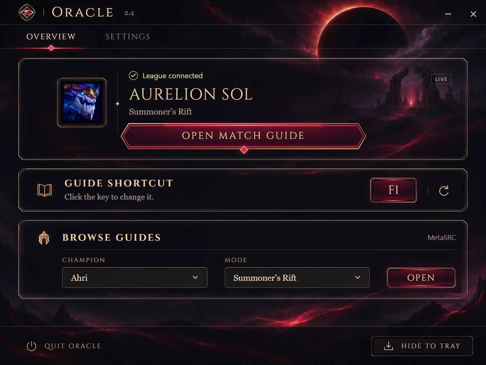
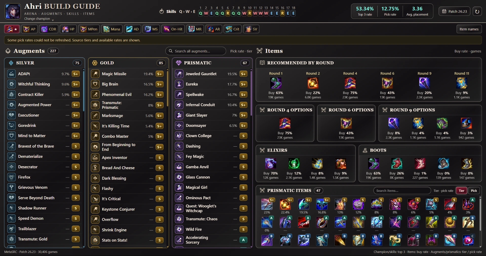
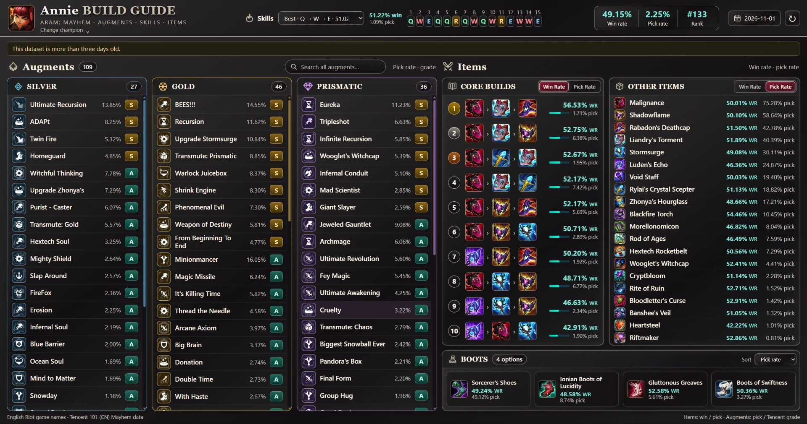

  

<h1 align="center">Oracle</h1>

<strong>Your champion’s League of Legends guide, one key away.</strong>

  Oracle is a Windows tray app that detects your champion and game mode in a supported match. 
  Press <kbd>F1</kbd> to check your build, skill order, or augments without searching mid-match.

  <strong><a href="https://github.com/frilo369/Oracle/releases/latest">Download for Windows</a></strong> · <a href="#supported-modes">Supported modes</a> · <a href="#getting-started">Getting started</a>

  
   Oracle’s Overview dashboard with an example match.

## How Oracle helps

- **Find the right guide mid-match.** Oracle picks the guide for your champion and mode. Use the shortcut when you need to check your next item or which ability to level.
- **Compare choices in one place.** See build paths, skill orders, and mode-specific stats side by side. In Arena and Mayhem, search for an augment by name to see its tier and pick rate when available.
- **Plan between games.** Use **Browse Guides** in **Overview** to pick any champion and supported mode. Oracle remembers your last selection.

## Supported modes

| Mode | What you can look up | Data |
| --- | --- | --- |
| **Summoner’s Rift** | Runes, summoner spells, skill order, and item paths | MetaSRC |
| **ARAM** | Mode-specific runes, skill orders, and builds | MetaSRC |
| **Arena** | Augment tiers, items by round, and Prismatic item options | MetaSRC |
| **ARAM Mayhem** | Searchable augments by tier, skill orders, and core item builds | Tencent 101 |

### Arena guide

### ARAM Mayhem guide

The screenshots show example data. Fresh recommendations depend on the provider and require an internet connection. The Mayhem guide shows the age of its cached data.

## Getting started

1. Download and run the Windows x64 setup from [the latest release](https://github.com/frilo369/Oracle/releases/latest).
2. Open Oracle from its icon in the Windows system tray.
3. In a supported match, press **F1** or choose **Open Match Guide**. Click the shortcut shown in **Overview** to change it.

Installed copies check for updates at startup and install them outside matches. Use **Settings → Check for updates** to check manually. If you’re upgrading from Oracle 1.8 or 1.9, run the current installer once to get the updater fix.

Oracle uses read-only local match detection. You can use it without a Riot API key, and your League files stay untouched.

## Beta testing

An optional augment overlay concept is in beta testing and off by default. The idea is to show tiers and pick rates next to the augments you’re offered.

Development and credits

Oracle uses Rust, Tauri 2, and WebView2. Local development requires Windows x64, Rust with MSVC, and WebView2.

| Task | Command |
| --- | --- |
| Fetch Rust dependencies on a fresh clone | `scripts/cargo.ps1 fetch` |
| Run locally | `scripts/cargo.ps1 run` |
| Verify | `scripts/verify.ps1` |
| Build the executable | `scripts/build.ps1` |
| Package the installer | `scripts/build-setup.ps1` |

Settings are stored in `%LOCALAPPDATA%\com.frilo369.oracle`. The standard installation is under `%LOCALAPPDATA%\oracle\bin`.

See the [guide behavior notes](docs/guide-behaviour.md), [release history](https://github.com/frilo369/Oracle/releases), and [source and artwork credits](docs/provenance.md).

Oracle is an independent project by FrYiLo. League of Legends and its artwork belong to Riot Games. Oracle has no affiliation with Riot Games.
