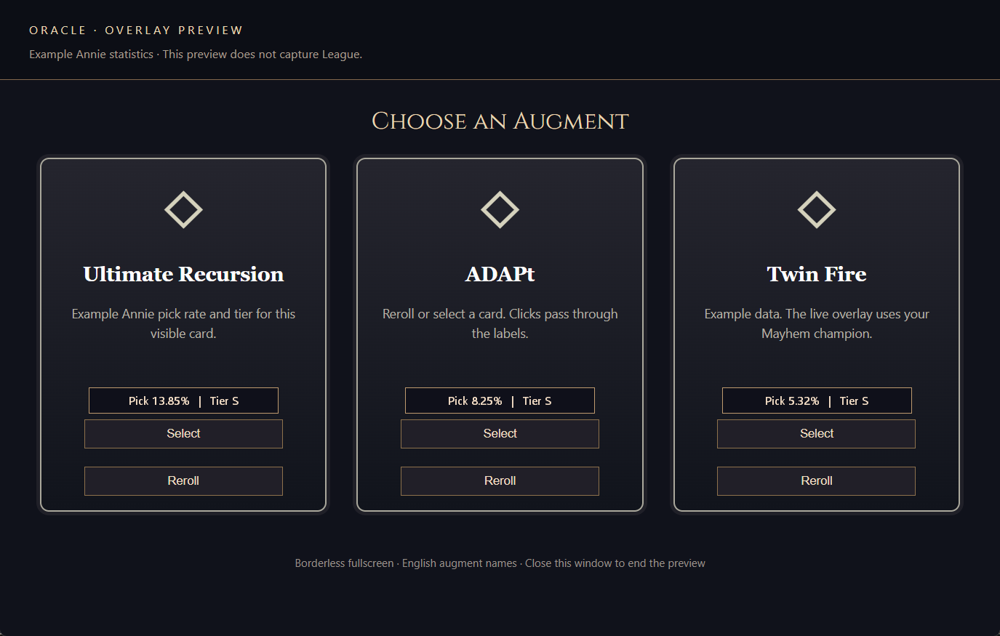

# Augment overlay beta · Oracle 2.2

The owner requested an automatic in-game augment overlay and then asked to start implementation. The initial scope is ARAM Mayhem, English augment names and borderless fullscreen. Arena and genuine exclusive fullscreen are outside this beta. See [the feasibility investigation](overlay-feasibility.md) for the policy and display-mode findings.

## Using it

Enable **Settings → Augment overlay · Beta**. Windows needs English text recognition installed (Language options → English → Optical character recognition). The setting defaults off and persists across restarts. League must be in an active Mayhem match and in front. Oracle uses the automatically detected champion, rather than the manual guide picker.

**Preview pick rates and tiers** opens example Annie cards and works independently of the live setting. Try a reroll, select a card, or switch to another window. The preview exercises Windows text recognition and the native overlay, rather than drawing simulated statistics inside the page. Example data comes from the existing bundled Tencent fixture and is labelled as such.

The labels show Tencent's champion-specific pick percentage and reported tier. Missing values show a dash; a stale offline response is marked Cached. Oracle does not invent augment win rates. Riot's [current League developer policy](https://developer.riotgames.com/docs/lol#_game-policy) specifically lists augment win-rate displays among unapproved use cases.

## Implementation

- `src-tauri/src/overlay/capture.rs` captures the eligible foreground client area into memory, scales to at most 1600×1000 and uses Windows English OCR. Focus and client bounds are checked before and after capture. No live screenshots or recognized text are saved or uploaded.
- `recognition.rs` requires a selection prompt and three distinct, aligned known titles. Matching tolerates punctuation and case; wrapped titles are joined only within the same column. Longer titles suppress their own contained word fragments, so Ultimate Recursion cannot become Recursion. Unrelated ambiguity, an unknown choice or an absent prompt hides the labels. Two consecutive agreeing frames are required; rerolls reset that agreement.
- `data.rs` reads the existing guide response and validates the champion. Mayhem's ARAM variant takes priority when Arena shares the display name (ADAPt: 1205 rather than 205). Equal-priority collisions are excluded. The existing guide fetch/cache/stale fallback is reused, with an hourly refresh limit.
- `window.rs` owns one transparent, layered Win32 window. It has `WS_EX_TOPMOST`, `WS_EX_NOACTIVATE`, `WS_EX_TRANSPARENT`, `WS_EX_TOOLWINDOW` and transparent hit testing. Opacity is explicitly 255 with both `LWA_ALPHA` and `LWA_COLORKEY`. Only label rectangles are painted; clicks and keyboard focus remain with the target. No game injection or League writes are used.
- `mod.rs` manages eligibility, statistics fetching and recognition on separate workers. Active scans are single-flight at roughly 500 ms intervals; the controller checks visibility every 75 ms while active and idles at 250 ms otherwise. Results older than one second are rejected and labels expire after 1.1 seconds without a valid refresh. There is no capture outside eligible foreground targets. Initial eligibility settles for 250 ms before capture.
- The local preview shares the dashboard's WebView environment but has no Tauri command capability. Its navigation is restricted to the bundled page. Preview creation runs off WebView callbacks. Existing guide focus/shortcut handling is unchanged.
- Disposable QA profiles can capture only their own explicit preview, never real League. Fixture diagnostics contain known catalogue matches and coordinates, not arbitrary recognized text. Fixture event writes are serialized to prevent interleaved JSON lines from workers.

## Validation and limits

Commands: `scripts/verify.ps1`, native Cargo Clippy with `-D warnings`, `node scripts/check-design.mjs`, `node scripts/check-updates.mjs`, `node scripts/check-performance.mjs` and `node scripts/check-overlay.mjs` against a workspace executable. The overlay helper compiles `tests/overlay-capture.cs` into a disposable `.test` folder and captures only the owned foreground preview for visual inspection.

`scripts/check-overlay-ocr.ps1 -PreviewImage <.test/overlay-.../preview-page.png>` independently exercises the real Windows OCR engine and title matcher against a rendered preview screenshot, without requiring foreground control. It does not substitute for desktop capture or live native-overlay acceptance.

Unit checks cover champion isolation, missing/stale values, the Arena/Mayhem ID collision, selection-prompt gating, distinct choices, stability, rerolls, wrapping, scale and ambiguous matches. Native overlay acceptance checks actual Windows OCR, labels, click-through styles/hit testing, foreground retention, resizing, rerolls, hiding on selection/focus changes, restricted preview capabilities and persisted settings. Native acceptance requires leaving the preview in front; user activity in other windows intentionally suspends capture.

Live Mayhem acceptance is still open. The prototype's prompt matching, title fonts, card geometry, reroll layout, HUD scaling, display resolution and multiple-monitor placement must be checked against actual offered cards. The preview is not evidence that every League configuration works. Genuine exclusive fullscreen is not supported by this ordinary desktop overlay. Cached catalogue names may lag a game patch; unknown choices stay hidden. No end-to-end game FPS measurement has been performed.

## Acceptance record · 25 November 2026

Development and native acceptance first used internal version 2.1. The final delivered version is 2.2 because installer acceptance caught .NET Framework ZIP entry names using backslashes. Packaging now writes `/` names explicitly under either PowerShell runtime. The invalid internal setup was renamed to `.failed` and is not a deliverable.

- `scripts/verify.ps1`: 41 Rust tests and 11 frontend tests passed; three explicit environment/live checks skipped by default. Strict Clippy passed. The separate real Windows OCR bitmap acceptance also passed (about 60 ms for the owned 1375×875 preview image).
- Native overlay: `.test/overlay-1795646133984/verified.json`. Three correct IDs and exact pick rates, foreground preserved, click-through styles/hit testing, real painted label pixels in desktop capture (24,706 at default size), rerolls, selection hiding, focus hiding, preview capability isolation, persisted settings and QA capture isolation passed. Minimum 800×600, 900×650 and default 1100×700 layouts fit without scrolling or covering descriptions; native label positions followed actual resized columns. Visual inspection passed, including the wrapped Ultimate Recursion title at minimum size.
- Approximate native preview measurements: initial recognition/labels 1,463 ms including window creation; focus-hide 92 ms; reroll update 827 ms; selection-hide 565 ms. These describe the isolated preview on this PC, not game FPS or guaranteed live latency.
- Native dashboard design: `.test/design-1795645558027` passed default/minimum/wide layouts. Updater acceptance: `.test/updates-1795645195538` passed startup/manual/error/defer/digest flows without a real installation. Performance acceptance: `.test/performance-1795645203406` retained zero idle mutations, zero hidden/minimized dashboard polls, and a 50 ms dashboard resume.
- Final 2.2 setup: `.test/installer-c53e5cc791434592af4f5e2453d05bed` passed installation, payload-hash verification, reinstall, uninstall and preservation of extra files/data. This test used Windows PowerShell, reproducing the runtime that exposed the original archive bug. The installed owner profile/app was not changed. Native overlay acceptance above used the final feature code under internal 2.1; 2.2 changes its version and packaging.

Earlier state-only native checks passed even though the labels were absent from screenshots. Creation-time topmost plus explicit opacity corrected this. The acceptance script now verifies actual desktop pixels as well as native window flags; do not remove that check or substitute a WebView-only screenshot. Fixture logs are serialized because worker writes previously interleaved JSON lines. Foreground changes intentionally pause recognition and can interrupt native QA.

